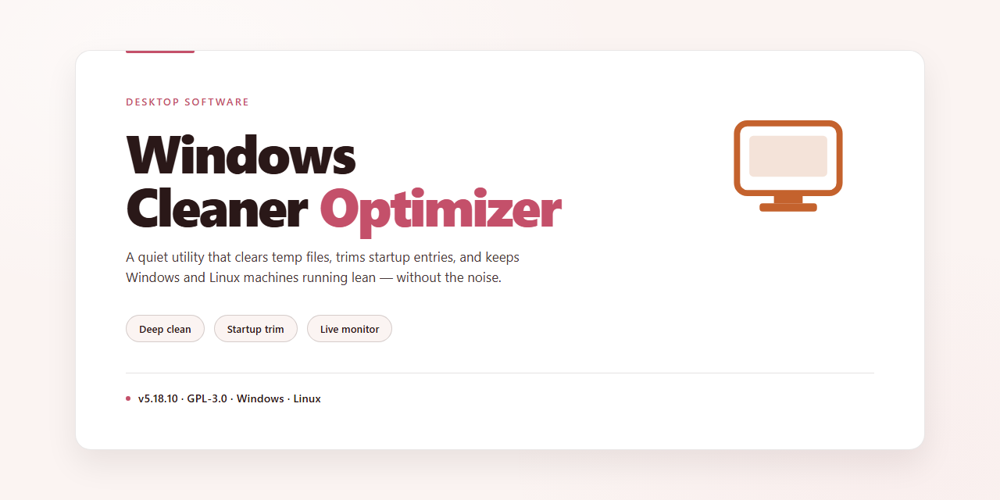

# ⚡ Windows Cleaner Optimizer – All-in-One Tuning Suite for Windows 10 & 11

### 💻 PowerShell Installer

  

---

Windows Cleaner Optimizer is an all-in-one desktop utility for Windows 10 and 11 that combines safe junk cleanup, memory optimization, and system tuning in a single native application. It provides over 90 reversible tweaks with debloat presets, gaming mode, integrated Windows and driver update management, GPU tooling, disk analysis, and DNS benchmarking. Every system modification is designed to be fully undoable, with restore points created automatically before changes are applied. The application operates without telemetry and requires no background services, giving users complete control over what is cleaned, modified, or restored.

## ✅ Before You Start

- **PowerShell 5.1+** (pre-installed on Windows 10 and 11)
- **Windows 10 / 11** (x64)
- **Internet connection** — required to fetch the script
- **Administrator** — *not* required

## Features

**System Dashboard** — A real-time overview of processor, graphics card (including temperature and video memory on supported NVIDIA hardware), memory, system drive, and network status. Aggregates a single health score with the contributing factors and a one-click recommended action.

- **Safe Junk Cleanup** — Removes caches and temporary files from Windows, browsers, games, and applications. Displays the size of each cleanup category before deletion, and never touches documents, downloads, browsing history, saved passwords, game saves, or application settings.

- **RAM Booster** — Frees up memory by trimming working sets and standby lists for a more responsive system under load, with before-and-after memory usage reported.

- **90 Reversible Tweaks & Debloat** — Roughly 90 Windows tweaks with one-click presets (Essential, Gaming, Privacy, Ultimate). Every tweak is fully reversible: disabling one restores the exact prior state. Includes removal of built-in bloat and Store apps.

- **Gaming Mode** — Suspends non-essential background processes and services during play, then restores them automatically when the session ends.

- **Windows & Driver Updates** — Detects and installs Windows updates and driver updates on demand. Windows Update is never disabled; updates apply only when explicitly selected.

- **GPU Tools** — Read GPU temperature, video memory usage, and utilization, with a built-in frame counter for monitoring in-game performance.

- **Disk Analyzer** — Visualizes disk space usage by folder and file type. Files you select for deletion are routed to the Recycle Bin and can be restored.

- **DNS Speed Test** — Benchmarks candidate DNS resolvers and switches to the fastest option with a single click; the change reverts instantly.

- **Program Management** — Uninstall applications with a leftovers scan, remove Store apps, and install or update programs in batch through the system package manager.

- **Automatic Cleaning** — Scheduled cleanups run through Windows Task Scheduler, so no background process is required and the app does not need to stay open.

- **Restore Points & Undo** — A system restore point is created before any system change, and every tweak, DNS change, and configuration adjustment can be undone.

- **Tray Operation & Notifications** — Minimize to the system tray for background operation; the app notifies through Windows when a long-running job completes.

- **Portable, No Telemetry** — Ships as a single portable executable with no telemetry. Update checks and online lookups occur only on explicit user action.

## How it works

Windows Cleaner Optimizer operates through a modular, layered architecture that separates analysis, execution, and rollback into distinct stages. On launch, the application enumerates system state without modifying anything: it maps installed applications, scheduled tasks, startup entries, services, drivers, registry hives, and disk usage into an in-memory model. Every action you take is first validated against this model, so the tool knows precisely what will change before anything is written.

**Scanning and analysis.** The cleaner walks known cache and temporary locations for Windows, browsers, and installed applications, aggregating reclaimable bytes per category. The disk analyzer builds a directory tree with size attribution, while the RAM booster samples working sets and standby lists to identify memory that can be safely released. The GPU and DNS modules query the relevant system interfaces read-only, presenting results without side effects.

**Tweak engine.** Each of the roughly 90 tweaks and debloat entries is defined declaratively with its target key, expected prior value, and new value. Applying a tweak records the original state to a local rollback journal, which is what makes every change reversible. Presets are simply ordered bundles of these definitions, so switching a preset off restores each journaled value in sequence rather than applying a blanket reset.

**Execution and safety.** Before any system-level modification, the optimizer creates a restore point. File deletions are restricted to regenerable caches; anything user-selected is routed to the Recycle Bin. Long-running jobs such as updates, driver checks, and game-mode transitions execute on background workers with progress reporting, and the tray integration keeps the process alive when the window is closed.

**Updates and maintenance.** Windows and driver update checks run through native system APIs and report availability without forcing installation. Program updates and installs are delegated to the system package manager, and the gaming mode temporarily suspends configured background services and processes, restoring them automatically when the session ends or the app exits.

**State and persistence.** Configuration, journals, and scheduled-task definitions are stored locally in the application data directory. No telemetry is transmitted; the only outbound requests are explicit user-initiated lookups, and each can be disabled in settings. Uninstalling the application removes its scheduled tasks and leaves the journal available for a final rollback if desired.

## Compatibility

Windows Cleaner Optimizer is designed for and tested on Windows 10 (version 1809 and later) and Windows 11, covering both x64 and ARM64 editions. All cleaning, optimization, and tweaking modules operate natively within the Windows environment and require no external runtime, framework, or dependency installation.

Administrator privileges are required for the majority of operations, including system-level cache removal, reversible tweaks, debloat routines, Windows and driver update management, and startup configuration. Read-only diagnostics — such as the disk analyzer and GPU monitoring tools — can run with standard user permissions, though full functionality is available only under an elevated session.

The application is distributed as a single portable executable. It does not write to the registry during normal operation beyond the explicit, reversible tweaks the user selects, and it leaves no persistent services or background agents after exit. Settings and user preferences are stored locally in a configuration file adjacent to the executable, preserving portability across machines.

Feature-level compatibility notes:

- **Junk cleanup** supports Windows 10/11 system caches, browser data directories for major Chromium and Gecko-based browsers, and application-specific cache locations for supported apps and game launchers.
- **RAM booster** interacts with the Windows memory manager and is compatible with both standard and high-memory configurations; behavior may vary under systems with custom page-file or memory-compression settings.
- **Reversible tweaks and debloat** target Windows 10/11 build-specific registry and policy locations. Each tweak records its prior state to guarantee one-click rollback.
- **Gaming mode** adjusts process priority and background activity; compatibility depends on the title and is not guaranteed to alter frame rates uniformly across all hardware.
- **Windows and driver updates** interface with the native Windows Update service and supported driver channels; availability depends on the installed Windows build and hardware vendor support.
- **GPU tools** expose monitoring and diagnostic data where supported by the installed graphics driver; advanced metrics such as temperature and video memory reporting require vendor driver support.
- **DNS speed test and configuration** operates on the active network adapter and supports standard Windows DNS client behavior.

Windows versions prior to Windows 10, including Windows 8.1 and earlier, are not supported. Systems with heavily modified Windows installations, third-party system-level hooks, or non-standard shell replacements may experience partial functionality. Virtualized environments are supported for diagnostics, but hardware-dependent features such as GPU monitoring may report limited or no data.

The application performs no telemetry collection and requires no network access for core cleaning and optimization functions. Network connectivity is used only for optional features explicitly initiated by the user, such as update checks and DNS resolution testing.

## FAQ

**Does the optimizer require administrator privileges?** Yes. Junk cleanup, most of the reversible tweaks, debloat operations, the driver and Windows update modules, and system-level disk analysis all need elevated rights. The application runs elevated as a whole; there is no separate non-elevated worker mode.

**What exactly does "reversible tweaks" mean?** Every one of the roughly 90 tweaks records the prior registry and system state before applying a change. Disabling a tweak restores the exact previous values rather than applying a generic default. A restore point is also created before any system-level modification, so changes can be rolled back at the OS level as well.

**Is the RAM booster a real memory reclamation tool?** It works by trimming working sets and flushing standby and modified page lists through native Windows memory-management interfaces. It does not install a kernel driver, does not modify page-file behavior, and does not persist after the application closes. It is intended for short-term relief, not continuous memory management.

**Which cleanup targets are covered, and what is explicitly excluded?** Cleanup covers Windows component and update caches, thumbnail and icon caches, browser caches, shader and game caches, and application temporary directories. It does not touch documents, downloads, browser history, saved passwords, cookies, game saves, or application configuration files. Each category displays its reclaimable size before any deletion runs.

**How does Gaming Mode affect the system?** Gaming Mode suspends selected background services and processes, adjusts scheduling priority for the foreground application, and disables a configurable set of non-essential scheduled tasks. All changes are recorded and reverted when the mode is turned off. It does not overclock hardware or alter GPU clock or voltage settings.

**Are Windows and driver updates installed automatically?** No. Both modules enumerate available updates and present them for selection. Installation only proceeds for items you explicitly confirm. Windows Update itself is never disabled or blocked by the application.

**How does the Debloat module handle removed packages?** Removed AppX packages and provisioned packages can be reinstalled from the application's debloat panel or restored via the created restore point. Changes to privacy-related Group Policy and registry keys are logged in the tweak ledger and can be reverted individually.

**Does the DNS module change my configuration permanently?** No. Applying a DNS preset writes the chosen resolver addresses to the active adapter, and a single revert action restores the previously configured servers, including automatic DHCP assignment. The module also runs latency measurements against candidate resolvers to support selection.

**What data does the application send externally?** The application includes no telemetry and no analytics. It performs a version check against the release repository, which can be disabled in Settings. Update and package installation operations use the system package manager. No diagnostic, usage, or hardware data is transmitted.

**Why might antivirus software flag the executable?** The application is unsigned and performs operations characteristic of system utilities, including file deletion, process termination, service manipulation, and registry writes. Heuristic and machine-learning detections are common for this class of software. Verify the binary against the published release checksum and add a local exclusion if you trust the source.

**Is the application portable, and where does it store data?** The application runs from its executable and does not require a system-wide installation for core functionality. Settings, tweak ledgers, and logs are written to a local configuration directory adjacent to the executable or under the user profile, and can be removed by deleting that directory.

**Which Windows versions and architectures are supported?** Windows 10 and Windows 11, x64. Some GPU monitoring and driver update features depend on vendor-specific interfaces and may be limited on unsupported hardware.

## Disclaimer

Windows Cleaner Optimizer is provided as a system utility for Windows 10 and Windows 11. By installing or running the software, you acknowledge that you have read and accept the terms outlined below.

**Intended Use.** Windows Cleaner Optimizer is designed to perform junk file cleanup, memory optimization, reversible system tweaks, debloat operations, gaming-mode adjustments, update management, driver and GPU tooling, disk analysis, and DNS configuration assistance. The software is intended for use by individuals who administer their own systems and who understand the effect of the operations they choose to enable. All tweaks and debloat actions are reversible by design, and a restore point is created before system-level changes are applied; however, reversibility depends on the integrity of the underlying Windows restore mechanism and on the user not having disabled it.

**Administrative Privileges.** Certain features — including cache removal, system tweaks, and application uninstallation — require elevated permissions. Running the software with administrator rights grants it the ability to modify system settings and delete files. Users should review each selected operation before execution and should not run the software on systems they do not own or are not authorized to administer.

**No Warranty.** The software is supplied on an "as is" and "as available" basis, without warranties of any kind, whether express, implied, or statutory, including but not limited to implied warranties of merchantability, fitness for a particular purpose, and non-infringement. No guarantee is made that the software will be error-free, uninterrupted, or compatible with every hardware configuration, driver version, or Windows build.

**Limitation of Liability.** To the maximum extent permitted by applicable law, the authors and distributors of Windows Cleaner Optimizer shall not be held liable for any direct, indirect, incidental, special, consequential, or punitive damages arising from the use of or inability to use the software, including but not limited to data loss, system instability, reduced performance, or loss of business or profits, even if advised of the possibility of such damages.

**User Responsibility.** You are responsible for maintaining independent backups of important data, for verifying that selected cleanup and optimization operations are appropriate for your system, and for ensuring compliance with any applicable organizational policies before deploying the software in a managed environment.

**Third-Party Components.** Where the software integrates with external package managers, system APIs, or diagnostic utilities, those components remain subject to their own respective terms and licensing. Windows Cleaner Optimizer does not alter or supersede those terms.

**Changes and Updates.** The software and this disclaimer may be revised at any time. Continued use following a revision constitutes acceptance of the updated terms.

## License

Windows Cleaner Optimizer is distributed under the MIT License — a permissive, OSI-approved open-source license that grants full freedom to use, copy, modify, merge, publish, distribute, sublicense, and sell copies of the software, provided the copyright notice and permission notice are preserved in all copies or substantial portions of the software.

From a technical standpoint, this means:

- **Unrestricted integration** — the codebase may be embedded in proprietary tooling, internal build pipelines, or commercial products without royalty obligations.
- **Full modification rights** — every module, including the cleanup engine, tweak registry, and GPU tooling, can be forked, refactored, or extended.
- **Redistribution freedom** — compiled binaries and source may be redistributed under the same terms, with attribution retained.
- **No warranty or liability** — the software is provided "AS IS", without express or implied warranties, including merchantability, fitness for a particular purpose, and non-infringement. In no event shall the authors or copyright holders be liable for any claim, damages, or other liability arising from the use of the software.

The full license text, including the copyright holder and year, is included in the LICENSE file at the root of the distribution. Retain it verbatim when redistributing.